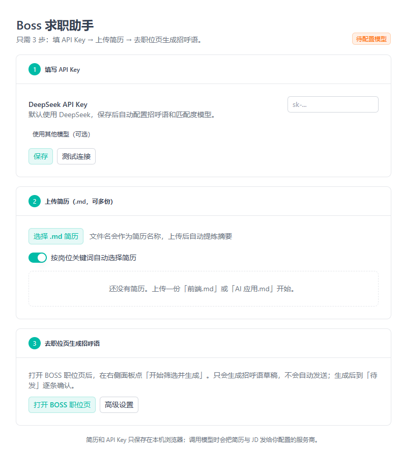

# Boss 求职助手（定制版）

基于 [Ocyss/boss-helper](https://github.com/Ocyss/boss-helper)（MIT）定制的浏览器扩展，面向**个人求职**场景。

> 上游项目本身是免费开源的。如果你看到“boss-helper 收费版”，那不是作者发布的，请勿购买。
> 本定制版与上游作者无隶属或背书关系。

## 最简单用法（默认简单模式）

1. 加载扩展后，打开扩展的「扩展程序选项」，会看到 3 步页面。
2. 填 DeepSeek API Key，点「保存」。
3. 上传一份或多份 `.md` 简历；文件名就是简历名称，岗位关键词用于按岗位自动选择。
4. 打开 `https://www.zhipin.com/web/geek/jobs`，右侧面板点「开始筛选并生成」。
5. 生成后切到「待发」，逐条编辑/发送/跳过。默认不会自动发送。



面板右上角「高级模式」和配置页底部「高级设置」可以回到完整配置。

## 招呼语格式

默认提示词会强制：

- 以「你好」开头（不是「您好」）；
- 以「岗位方向与我的经历较为匹配，希望进一步沟通！」结尾；
- 第一句写身份 + 对贵司岗位感兴趣，第二句用实习/项目证明能力，第三句突出技术栈；
- 只写掌握/具备/能熟练使用，不写「正在学习/还在学习」；
- 不会编造简历里没有的学校、公司、项目或数字。

生成后仍建议在「待发」里抽检几条。

## 相对上游的增量

1. **简历模块**：简单模式支持 `.md` 多份上传；高级模式还支持 PDF / DOCX / TXT，本地解析。解析后可让 LLM 提炼成「摘要 / 技能 / 年限 / 项目」。
2. **多份简历**：每份简历可设置岗位关键词，按当前岗位标题/JD 自动选择最匹配的一份。
3. **AI 只写招呼语**：移除了 AI 岗位筛选和 AI 匹配度，岗位筛选完全由「筛选配置」里的规则（岗位名、公司、薪资、活跃度、猎头等）完成。
4. **Prompt 变量**：新增 `{{resume.summary}}`、`{{resume.skills}}`、`{{resume.years}}`、`{{resume.projects}}`，招呼语提示词可以直接用。
5. **保守节奏**：默认 30/天、90 秒基础间隔（±25% 随机抖动，约 68–113 秒）、工作日 9:00–18:00 时段；连续 3 个岗位失败自动停止；移除了“120 人限额弹窗后继续投”的绕过逻辑。
6. **待发队列**：生成后进入「待发」页签，可逐条编辑、发送或跳过；默认不会自动发送。生成过程中也可以直接发送已经生成的草稿，不用等全部生成完。

## 构建

```bash
# Node 20+，pnpm
pnpm install --config.node-linker=hoisted
pnpm build:chrome
```

产物在 `.output/chrome-mv3`。

> 仓库已从 pnpm workspace 改为单项目（`devlog-ui` 通过 `wxt.config.ts` 别名指向本地 `packages/devlog-ui/src`），避免 Windows 下 workspace 符号链接递归。

## 加载

1. 打开 `chrome://extensions`（Edge 为 `edge://extensions`）。
2. 打开「开发者模式」。
3. 「加载已解压的扩展程序」，选择 `.output/chrome-mv3`。
4. 打开 BOSS 直聘职位列表页，右侧会出现「Boss 求职助手」面板。

## 高级模式配置（可选）

1. **配置 → AI → 提供商**：新建一个 OpenAI 兼容模型（DeepSeek、通义、Kimi、智谱等），填 Base URL、API Key、模型名，测试连接。
2. **配置 → AI → 简历**：上传 PDF/DOCX，或粘贴原文；选模型后点「AI 提炼」，检查摘要/技能/年限/项目，保存配置。
3. **配置 → AI → 招呼语**：启用 AI 招呼语，确认提示词里引用了 `{{resume.summary}}` 等变量。
4. **配置 → 基础设置**：确认投递数量 20–30、工作时段、通知等。
5. **配置 → 延迟配置**：默认 10s 开始、90s 间隔、120s 翻页；建议不要调低。

> 岗位筛选使用「筛选配置」里的规则，AI 不参与筛选。

## 推荐使用流程

**简单模式：**

1. 配置页填 API Key → 上传 `.md` 简历。
2. 职位列表页点「开始筛选并生成」。
3. 切到「待发」，逐条检查、编辑；确认后点「发送」。
4. 不要一上来追求全自动；先每天 5–10 条测试。

**高级模式：**

1. 职位列表页点「开始筛选并生成招呼语」，先看筛选结果和草稿。
2. 到「待发」逐条检查、编辑；确认后点「发送」。
3. 「开始投递」是全自动模式，等话术和账号稳定后再考虑。

## 安全边界

- 默认不自动发送；「开始投递」仍保留，但请只在明确了解风险时使用。
- 达到平台沟通上限会直接停止，不再尝试绕过弹窗。
- 检测到连续失败会暂停；遇到验证码请立即停止，不要尝试绕过。
- 简历与 API Key 只存在本机浏览器存储；调用第三方模型时，简历与 JD 会发送给对应服务商。

## 已知限制

- 扫描版 PDF（图片型）解析不出文字，需要 OCR 或手动粘贴。
- PDF 表格/多栏排版可能提取顺序错乱，建议提炼后人工检查摘要。
- 岗位详情、发送仍走上游的 BOSS 内部接口/聊天协议，不是纯 DOM 点击；账号风险由使用者承担。
- 端到端发送需要你自己的 BOSS 登录态，开发者无法代测。

## 许可证

上游为 MIT，但上游 README 写有“禁止用于商业用途”。两者存在冲突：
- 个人自用没有问题；
- 对外分发/收费前，请先联系上游作者确认，或只保留代码参考、重写发送层与 UI。
